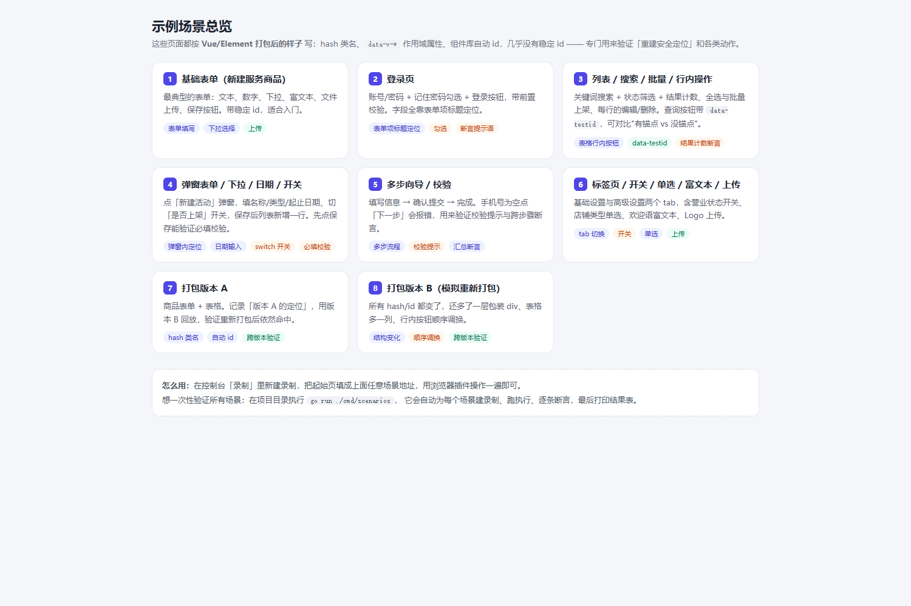
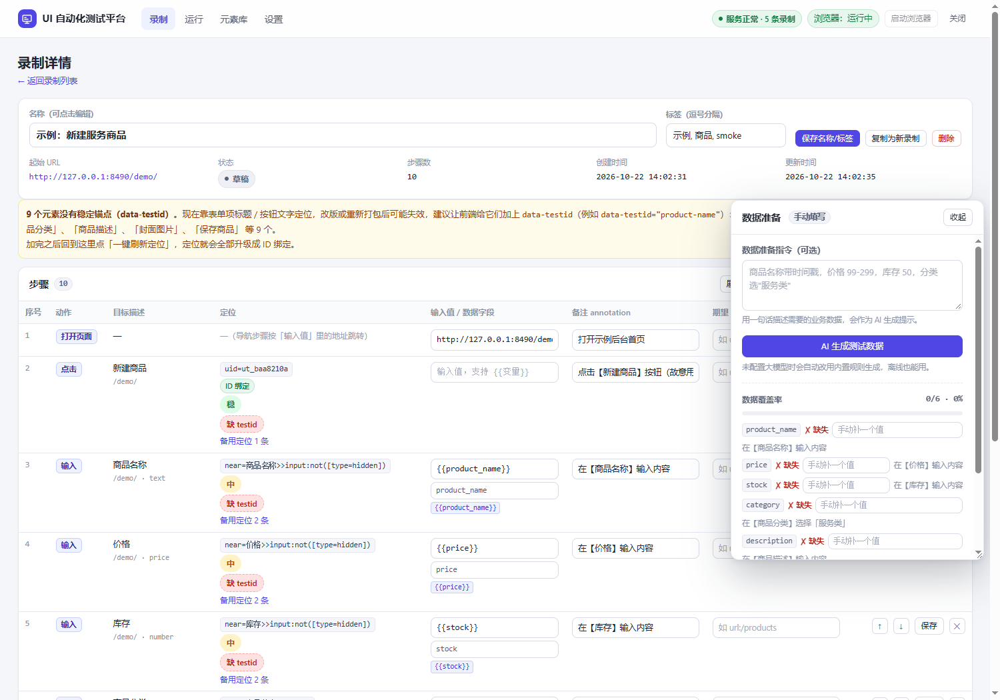
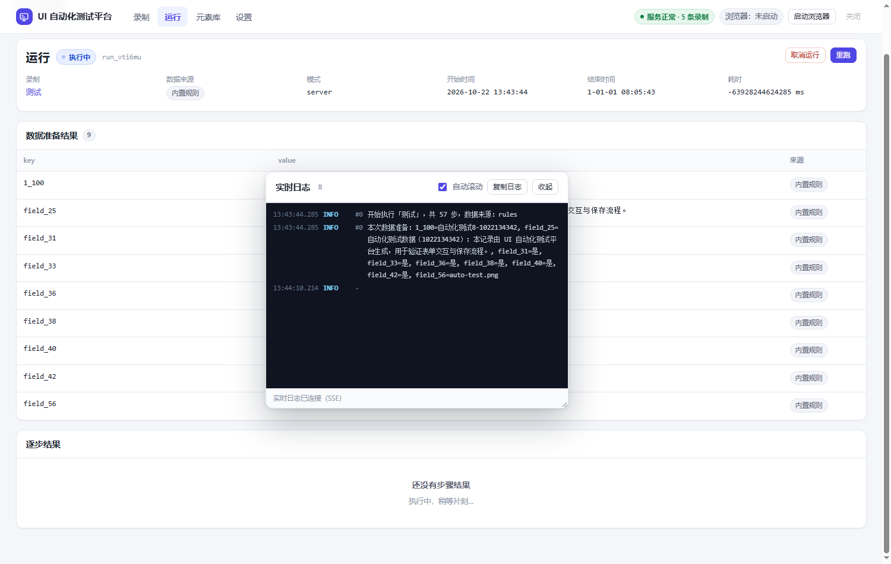
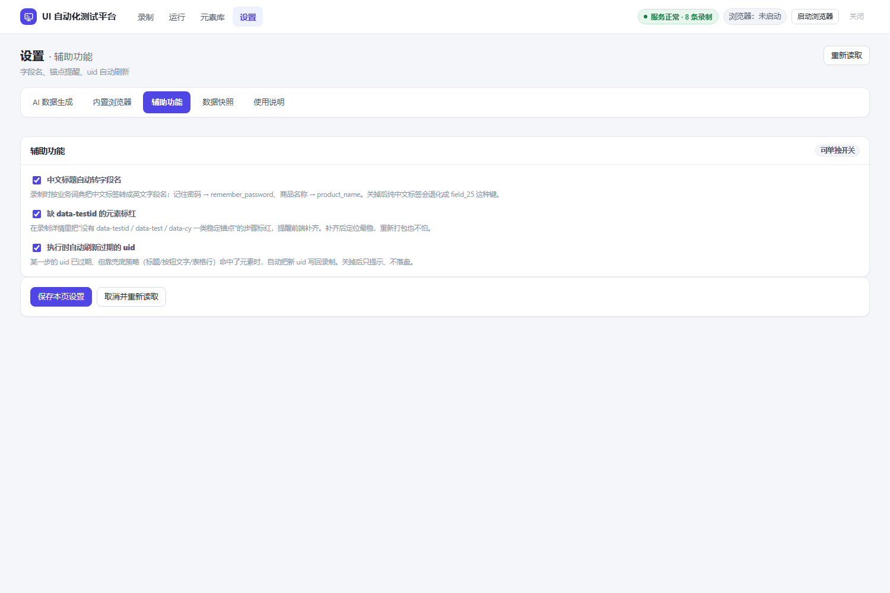

# UI 自动化测试平台 · 接口采集

> **在业务页面上正常点一遍**，就得到一条可回放的测试流程；
> **在业务页面上正常点一遍**，也就得到一个能定时跑的数据管道。

单文件 Go 服务端 + 浏览器插件控制台，零构建步骤（前端是原生 JS），Windows / Linux 同一份代码。

<p>


</p>
<p>


</p>

---

## 一、两条产品线

| 线 | 你做什么 | 得到什么 | 手册 |
|---|---|---|---|
| **UI 自动化** | 插件录一遍业务流程 | 可回放的步骤（稳定定位 + 自愈），一键执行、逐步截图与日志 | [docs/GUIDE.md](docs/GUIDE.md) |
| **接口采集** | 插件（或内置浏览器）录一遍接口 | 定时抓取任务：自动翻页 → 拍平成行 → 写 SQLite/MySQL/PG/Excel/JSON | [docs/COLLECT.md](docs/COLLECT.md) |

两条线共用同一套底座：录制 → 筛选 → 配置 → 执行 → 看结果；数据都落在 `data/`。

---

## 二、30 秒跑起来

```powershell
cd uitest
.\build.ps1                      # 编译到 dist\（或双击 build.cmd；-All 出三平台，-Clean 先清空）
.\dist\uitest-server-windows-amd64.exe   # 或 .\start.ps1 开发态后台启动 / .\stop.ps1 停止
```

不想要 `dist\` 也行，`go build -o uitest-server.exe .` 一样能跑；依赖全是纯 Go（含 SQLite/MySQL/PG 驱动、Excel 写入库）。

打开 <http://127.0.0.1:8490> → 首次启动会自建 `data/`（数据文件、日志、快照、浏览器 profile）。

**想让同网段的其他机器也能访问**（`config.json` 里 `server.host` 默认已经是 `0.0.0.0`）：

```powershell
.\dist\uitest-server-windows-amd64.exe -host 0.0.0.0     # 或 .\start.ps1 -Bind 0.0.0.0
# 启动日志会直接把本机所有可用地址列出来，例如：
#   控制台      http://127.0.0.1:8490/
#   局域网访问  http://192.168.1.23:8490/
```

只想本机用：把 `server.host` 改回 `127.0.0.1`（或 `-host 127.0.0.1`）。
首次以 `0.0.0.0` 启动时 Windows 可能弹出「是否允许此应用通过防火墙」，选允许（专用网络）才能被同网段访问。
⚠️ 控制台与 API **没有登录鉴权**，绑到 `0.0.0.0` 等于把「启动内置浏览器 / 改配置 / 跑采集任务」的权限开放给同网段，
请只在可信网络使用；需要更严一点就用防火墙只放行你自己的 IP：

```powershell
netsh advfirewall firewall add rule name="uitest-8490" dir=in action=allow protocol=TCP localport=8490 remoteip=192.168.1.0/24
```

**UI 自动化**（5 分钟）：

1. 装插件：`edge://extensions` → 开发人员模式 → 加载解压缩的扩展 → 选 `extension/`；
2. 「录制」→ 新建录制 → 起始页填 `http://127.0.0.1:8490/demo/admin-list.html` → 开始录制；
3. 回业务页正常操作（搜一下、点行内按钮、关弹窗）→ 停止录制；
4. 录制详情右侧「数据准备」写一句 `价格 99-299，库存 50` → 「AI 生成测试数据」（没配模型自动用内置规则）；
5. 点「执行测试」→ 运行详情看逐步结果、实际定位与实时日志。

**接口采集**（5 分钟）：

1. 左侧菜单「接口采集 → 录制接口」→ 两种录法任选：
   - 插件弹窗里勾着「同时录制接口请求」，在你自己的浏览器里正常操作（推荐）；
   - 或在「录制接口」卡片里填 `http://127.0.0.1:8490/demo/api-center.html`，用内置浏览器录；
2. 停止录制 → 进「录制结果」勾选要抓的接口（可先筛选、可删掉心跳/埋点）→「下一步：配置采集任务」；
3. 定时选「每 1 小时」、落库选「Excel 表格」→ 创建 → 点「立即运行」；
4. 「接口采集 → 执行日志 → 查看」看这次跑得怎么样：**每次请求与响应都按顺序记在运行日志里**（明文，含 Cookie / 请求头 / 请求体 / 响应体），分页跑多页就有多组；勾「只看请求/响应」可以先把业务日志滤掉；
5. 「接口采集 → 产出文件」下载 `.xlsx`（示例数据 23 条、每页 3 条，会自动翻完 8 页）。

想让**不同接口写不同表 / 不同文件**：任务详情里勾「每个接口单独分表 / 分文件」（表名 = 任务表名 + 接口名），
或在某个接口上单独填「写入表 / 文件名」。「接口采集 → 数据写入」里维护可复用的连接配置（新建 / 测试 / 保存 / 删除）。

**录制只记「接口地址 + 请求参数」**：Cookie / Authorization / User-Agent / Referer 这类登录态头不写进录制结果（只留 `Content-Type`），
运行期全部由任务的**会话**实时提供——否则任务里会钉死一份过期值，还会和会话 Cookie 重复。

**采集任务本质是回放录制会话里那几条请求**：建任务时会把每条请求的原始信息存一份快照在接口上，
任务详情展开任一接口，既能看到「录制时的请求数据」（请求头明文含 Cookie、请求体、来源页面与录制时间），
也**可以直接改请求头和请求体**（点「填入请求头 / 填入请求体」把录制值搬下来再改，保存后抓取就用你改的值）。

**公共参数 + 页签式任务详情**：任务详情分成 概览 / 公共参数 / 登录 / 接口设计 / 调度与落库 五个页签；
「公共参数」里配所有接口共用的 query/body 参数、公共请求头，以及**登录成功后执行的脚本**（可读 localStorage / cookie，
返回 `{"params":{…},"headers":{…}}` 或 `{"token":"…"}`）。优先级：公共参数 → 接口配置 → 前置登录后的浏览器头 → 脚本。

**落库 SQL 可查**：运行日志里 `SQL` 级别的行会打印建表 / 补列 / 建索引 / INSERT 模板与每批展开的整句 SQL（可勾「只看 SQL」）。

**跑完推企业微信群**：设置 →「运行通知」填 Webhook + 勾「成功时推送 / 失败时推送」，**一次配置所有采集任务共用**；
任务跑完就推一条 markdown（任务名、状态、触发方式、接口成功/失败数、请求数、写入行数、耗时、错误原因、运行日志链接）；
推送是异步的，失败只记一条 warn 到运行日志，不影响采集本身；点「发一条测试」可先验证 webhook（见 [COLLECT 8.1](docs/COLLECT.md)）。

**会话三选一，所有接口共用一份**（任务详情「登录」页签，见 [COLLECT 3.1](docs/COLLECT.md)）：

- **UI 自动化登录**：选一段录好的前置动作，运行前先在浏览器里真点一遍（打开页面 → 输入 → **AI 验证码** → 点击提交），
  登完立刻导出浏览器会话，抓取时 Cookie 与请求头全部共享浏览器的（`Authorization` / `User-Agent` / `X-*` 都是实时值）；
- **登录接口换 token**：直接 `POST` 账号密码换 token（顺带收 `Set-Cookie`），**完全不开浏览器**，适合无人值守定时跑；
- **仅导入**：只用「公共参数 → 粘贴导入」的 Cookie / 参数，完全不碰浏览器。

拿到的新 token / Cookie 会自动**写回公共参数**（公共参数页签还有「刷新会话并写回参数」按钮），再由参数绑定
`token -> header:Authorization = Bearer {{token}}` 注入请求头，所以永远用的是刚登录的值。
用 UI 自动化时**「登录用变量」必须填 `password=...`**（录制器会把密码框脱敏成 `{{password}}`，不填就登不进去），
可选「只在会话失效（401/403）时补跑」；点「自检」能逐步看到登录、Cookie、请求头每一步的结果（见 [COLLECT 3.3](docs/COLLECT.md)）。

想先要演示数据？`powershell -ExecutionPolicy Bypass -File scripts\seed-demo.ps1`
（`data/` 不入库，新克隆的仓库第一次是空的，跑它就能生成 7 条示例流程、共 63 步）。

想验证**登录态 / 含页面文档录制**，服务自带一套"需要登录"的示例，不用接你的真实系统：
打开 `/demo/collect-login.html`（`admin` / `123456`）→ 进 `/demo/collect-orders.html` → 用「接口采集」录它（范围选含页面文档）
→ 建任务时配好「前置登录」，运行日志里就能看到 `Authorization` 用的是浏览器里最新的 token。

---

## 三、能力总览

### UI 自动化

| 能力 | 说明 |
|---|---|
| 录制即脚本 | 插件把点击/输入/选择/勾选/上传/断言实时上报，每步自动生成中文备注 |
| 稳定 ID 绑定 | 录制时算 `data-uitest-id`（确定性算法），执行优先用它；失效时多级语义兜底 + 指纹自愈 |
| 重新打包安全 | hash 类名、`data-v-*`、组件库自动 id 全部过滤，只认表单项标题/按钮文字/表格行等业务语义 |
| AI 数据准备 | OpenAI 兼容接口；未配置或失败自动退到内置规则（能听懂「价格 99-299」这类指令） |
| 一键刷新定位 | 老录制（只有 css）一次升级成全量 uid，语义优先重算，不固化有歧义的 css |
| 实时日志 | SSE 推送，悬浮窗可拖动/缩放/复制；断流自动退轮询 |
| 可配置收尾 | 运行结束按设置关标签页 / 关浏览器 / 保留现场 |
| 数据快照 | 每次启动留快照，误删可一键恢复（恢复前自动再存一份） |

### 接口采集

| 能力 | 说明 |
|---|---|
| 零侵入录制 | 插件录（你自己的浏览器，登录态/代理都不受影响）或内置浏览器 CDP 旁路录，都不装代理、不改页面 |
| 会话三来源 | UI 自动化登录（前置动作跑一遍浏览器）/ 登录接口换 token（顺带收 `Set-Cookie`）/ 仅导入 Cookie，**所有接口共用一份会话**；登录后的新 token / Cookie 自动写回公共参数 |
| 前置动作 + AI 验证码 | 采集前先在浏览器里走「打开页面 → 输入 → AI 识别验证码 → 点击提交」拿到登录态；也可以直接调登录接口换 token，不开浏览器 |
| 试抓时间线 | 试抓不只给结果：按「前置动作 → 会话 → 登录 → 刷新参数 → 变量 → 请求 → 响应 → 解析」逐步列出请求参数与打码后的报文，可先跑前置动作再试抓 |
| 结果可裁剪 | 逐条删除 / 勾选批量删除 / 按筛选结果整体删除；删掉的不会被插件重发加回 |
| 自动识别结构 | 自动找记录数组（`data.list`）、推断字段映射（`owner.name → owner_name`），可手改 |
| 自动翻页 | 页码 / 偏移 / 游标 / 请求体内参数四种形态；按总数·has_more·短页停；连两页相同即判"不吃分页"，重复行去重 |
| 落库 6 种 | SQLite、MySQL、PostgreSQL、**Excel `.xlsx`**、**JSON `.json`**、JSONL；前两类文件可在控制台直接下载 |
| 一键清空 | 首页「清空数据」可分别清掉产出文件 / 采集任务与运行记录 / 仅运行记录 / 内存里的录制结果 |
| 自动建表补列 | 表不存在自动建，响应多字段自动 `ALTER TABLE ADD COLUMN`；`upsert` 按主键覆盖 |
| 礼貌采集 | 单任务串行 + 最小间隔 + 随机抖动 + 指数退避；429 按 `Retry-After` 等；401/403 立即停手；连续失败熔断 |
| 先看再写 | 「试抓预览」不写库看列与前几行；「测试落库」只验连接 |

> **边界**：面向**你有权访问的系统**（自家后台、测试环境、内部系统）。
> 只做"像人一样正常访问"，不做代理池 / 指纹伪造 / 验证码绕过这类对抗风控的事
> （`AI 验证码` 只是把你**有权访问**的系统里那张图片读出来填回输入框，不做打码平台、不做反检测）。

---

## 四、目录地图

```
uitest/
├─ main.go                 # 入口：配置合并、go:embed web/demo、路由装配
├─ internal/
│  ├─ api/                 # HTTP 接口（录制/步骤/运行/元素/设置/备份/SSE/采集/产出文件）
│  ├─ browser/             # 内置浏览器：启动自愈、CDP 页面操作、netcap.go（旁路录请求）
│  ├─ cdp/                 # 极简 CDP 客户端（WebSocket + 请求/事件）
│  ├─ engine/              # 执行器：步骤执行、变量替换、自愈回写、一键刷新定位
│  ├─ collect/             # ★ 接口采集：筛选/分页/调度/执行/sink（SQL·Excel·JSON）
│  ├─ ai/ keyname/         # AI 与规则数据生成、中文标签 → 英文字段名
│  ├─ model/ store/ config/# 数据模型、JSON 持久化（含快照）、配置
│  └─ bus/                 # 事件总线（SSE 实时日志）
├─ runtime/uitest-keys.js  # ★ 浏览器侧共享运行时（定位/动作唯一实现，go:embed）
├─ extension/              # MV3 插件（UI 录制 + 接口录制，与 runtime 共用同一份运行时）
├─ web/                    # 控制台：app.js 主控制台、collect.js 采集页（原生 JS，无构建）
├─ demo/                   # 8 个示例页面 + gallery.html 总览 + api-center.html（采集演练页）
├─ cmd/scenarios/          # 一键跑全部示例场景的验证工具
├─ scripts/                # 自检 / 生成示例数据 / 下载内核 / 交叉编译
├─ docs/                   # GUIDE · COLLECT · API · screenshots
└─ data/                   # 运行时目录（不入库）：uitest.json、runs/、logs/、backups/、harvest/
```

要点：

- `data/` 是**运行时状态**，已在 `.gitignore` 里整目录忽略；删掉重启即重建（录制与采集配置也会没有）。
- `runtime/uitest-keys.js` 与 `extension/uitest-keys.js` 必须**保持一致**（插件现场用的就是它），改完请两边同步。
- 前端没有构建步骤：改 `web/*.js|css` 后重启服务端（文件是 `go:embed` 进去的）。

---

## 五、自检与构建

| 命令 | 作用 | 期望输出 |
|---|---|---|
| `go test ./...` | 单元测试（定位/筛选/截断/ETag 等纯逻辑） | 全部 `ok`，无 FAIL |
| `scripts\smoke.ps1` | 单条流程 + 自愈 + 回写 | 自检通过 ✅ |
| `scripts\collect-smoke.ps1` | 采集全链路（录制→建任务→执行→校验行数） | 接口采集自检通过 ✅ |
| `scripts\collect-extension-smoke.ps1` | 插件上报 → 删接口 → 用剩下的建任务 | 插件录制自检通过 ✅ |
| `scripts\collect-paging-smoke.ps1` | 5 种分页形态（页码/偏移/游标/请求体/假分页） | 分页采集自检通过 ✅ |
| `scripts\collect-files-smoke.ps1` | Excel + JSON 落库、下载、upsert 不重复 | 文件落库自检通过 ✅ |
| `go run ./cmd/scenarios` | 7 条示例流程（63 步）跨版本回放 | 场景结果：7/7 通过 ✅ |
| `build.ps1` / `build.cmd` | 根目录编译入口，转发到 `scripts\build.ps1`（`-All` / `-Clean` / `-Targets`） | `dist/` 里是可直接运行的二进制 |
| `scripts\collect-selftest.ps1` | 接口采集自动化自测：自己编译 + 起独立实例（独立端口/数据目录）→ 测 demo 登录、含页面文档录制、建任务运行，逐项 PASS/FAIL | `-Keep` 跑完不关服务方便手工点；`-NoBuild` 复用上次的 exe |
| `scripts\build.ps1` | 编译到 `dist\`：默认当前平台，`-All` 出 windows/amd64 + linux/amd64 + arm64，`-Clean` 先清空，附带 `config.json` 与 `BUILD.txt` | 同上 |
| `scripts\build-all.ps1` | 老命令，等价于 `build.ps1 -All` | 同上 |
| `scripts\seed-demo.ps1` | 生成示例录制（等价于 `cmd/scenarios -keep`） | 控制台「录制」列表有 7 项 |

自检脚本都用独立端口 + 独立数据目录，跑完自动清理，**不会动你的 `data/`**。

---

## 六、配置

`config.json` 与 `data/uitest.json` 里的设置会合并，环境变量优先级最高：

| 变量 | 作用 |
|---|---|
| `UITEST_PORT` | 监听端口（默认 8490；也可用 `-port` 启动参数） |
| `UITEST_HOST` | 监听地址（`config.json` 默认 `0.0.0.0`，局域网可访问；只想本机用填 `127.0.0.1`；也可用 `-host` 启动参数） |
| `UITEST_DATA_DIR` | 数据目录（默认 `data`） |
| `UITEST_BROWSER` | 浏览器可执行文件路径 |
| `UITEST_HEADLESS` | `1` = 无头 |
| `UITEST_AI_BASE_URL` / `UITEST_AI_KEY` / `UITEST_AI_MODEL` | 大模型数据生成 |

界面上的设置（AI / 浏览器 / 辅助功能 / 数据快照）见 [GUIDE 7.3 设置](docs/GUIDE.md#73-设置)。

---

## 七、文档

| 文档 | 内容 | 什么时候看 |
|---|---|---|
| **[docs/GUIDE.md](docs/GUIDE.md)** | 控制台使用手册：四个教程、界面导览、定位机制、数据与断言、浏览器、排错 FAQ | 想跑通 UI 自动化 |
| **[docs/COLLECT.md](docs/COLLECT.md)** | 接口采集手册：录制、筛选与裁剪、任务配置、分页、落库与下载、部署、FAQ | 想把接口数据定时入库 |
| **[docs/API.md](docs/API.md)** | HTTP 接口契约：通用约定、全部端点、数据模型、curl 示例 | 要写脚本 / 接第三方 |
| **[extension/README.md](extension/README.md)** | 插件手册：安装、权限、UI 录制、接口录制、稳定 ID 原理、FAQ | 改插件或排查插件问题 |

示例页面：<http://127.0.0.1:8490/demo/gallery.html>（8 个示例页面总览，覆盖表单/登录/列表/弹窗/向导/标签页/跨版本打包）、
<http://127.0.0.1:8490/demo/api-center.html>（四种分页形态 + 固定 23 条数据）。

---

## 八、已知限制

| # | 限制 | 说明 / 规避 |
|---|---|---|
| 1 | 内容脚本只在页面加载时注入 | 装/更新插件后刷新被测页面 |
| 2 | iframe 内操作有记录但执行以主框架为主 | 跨 iframe 步骤建议人工确认 |
| 3 | 富文本（Quill/ProseMirror）取值可能不准 | 用断言兜底，或改 `data_key` 手填 |
| 4 | 上传只录到文件名 | 执行时用数据准备里的值当本地路径，空则用内置示例 PNG |
| 5 | 画布/拖拽类组件只能定位容器 | 做不到像素级操作 |
| 6 | 运行记录默认保留 200 条（`storage.keep_runs` 可调），采集运行记录固定 300 条 | 超出的自动清理 |
| 7 | 单机单进程，不搞多租户 | 可并行多个 run，但共享一个浏览器进程 |
| 8 | 内置浏览器只能访问本机能访问的网络 | 内网/离线环境打开外网必然失败 |
| 9 | 采集录制结果只存内存 | 服务重启即清空（任务与已入库数据不受影响） |
| 10 | 采集会话只有浏览器一种来源，运行机必须能起 Chromium | 无桌面 Linux 设 `browser.headless=true` + `browser.no_sandbox=true`，或用 `browser.debug_url` 接现成的 CDP 端点 |
| 11 | 礼貌采集是**刻意限制** | 需要更快请拆成多个任务，而不是把间隔调到 0 |
