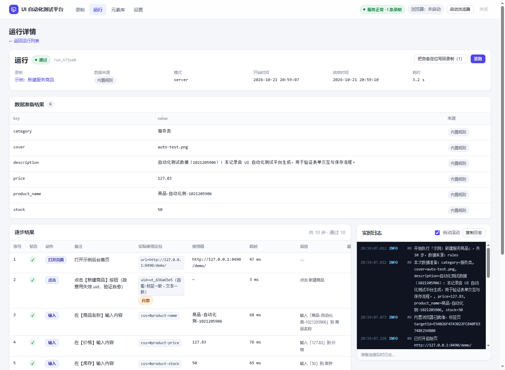
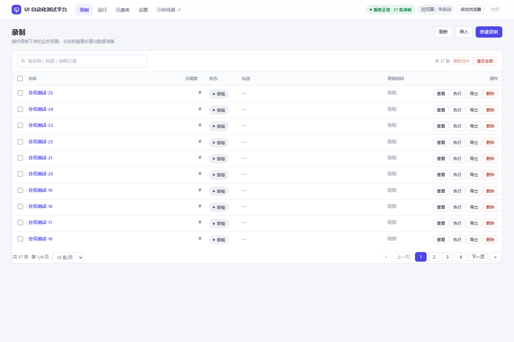

# UI 自动化 · 使用手册

> 面向"要真的把业务流程跑起来"的人。四个教程 + 三张原理表 + 一张排错表。
> 只想先跑通？看[第 3 章](#3-教程-a录一条完整流程)和[第 4 章](#4-教程-b生成数据并执行)就够。
> 想抓**接口数据**而不是点 UI？那是另一条线，见 **[COLLECT.md](COLLECT.md)**。

## 目录

1. [它解决什么问题](#1-它解决什么问题)
2. [安装](#2-安装)
3. [教程 A：录一条完整流程](#3-教程-a录一条完整流程)
4. [教程 B：生成数据并执行](#4-教程-b生成数据并执行)
5. [教程 C：看运行详情](#5-教程-c看运行详情)
6. [教程 D：页面重新打包后不失效](#6-教程-d页面重新打包后不失效)
7. [界面导览](#7-界面导览)
8. [定位机制详解](#8-定位机制详解)
9. [数据字段 / 模板变量 / 断言](#9-数据字段--模板变量--断言)
10. [内置浏览器](#10-内置浏览器)
11. [排错 FAQ](#11-排错-faq)
12. [验收清单](#12-验收清单)

---

## 1. 它解决什么问题

| 传统做法 | 这里 |
|---|---|
| 手写选择器（`#app > div:nth-child(3) input`），改版就碎 | 录制时自动算**稳定 ID**（`data-uitest-id`），打包后不变；失效还有多级兜底 + 自愈 |
| 每次手工编测试数据（"价格填多少？"） | 写一句中文指令让 AI（或内置规则）生成，字段值自动替换进步骤 |
| 出问题只知道"失败在第 5 步" | 每步有实际用的定位、耗时、失败截图、悬浮实时日志，现场可留可关 |
| 不知道定位稳不稳 | 每个定位带 **稳 / 中 / 弱** 徽章，缺 `data-testid` 的元素标红并汇总成清单 |

一句话：**录一遍 → 生成数据 → 一键执行 → 看日志定位问题**，页面重新打包后靠 `uid` 继续跑。

---

## 2. 安装

### 2.1 服务端

```powershell
cd uitest
.\scripts\build.ps1               # 编译到 dist\（当前平台；-All 出三平台）
.\dist\uitest-server-windows-amd64.exe   # 前台；或 .\start.ps1 后台启动、.\stop.ps1 停止

# 也可以不用 dist：go build -o uitest-server.exe . && .\uitest-server.exe
```

打开 <http://127.0.0.1:8490>。首次启动会自动：建 `data/uitest.json`（数据文件）、
给当前数据留一份 `data/backups/` 快照、探测可用浏览器内核。

| 命令 | 作用 |
|---|---|
| `.\start.ps1` | 后台启动，日志写 `data-start.log`（`-Bind 0.0.0.0` 可对局域网开放） |
| `.\stop.ps1` | 停止后台实例 |
| `scripts\fetch-browser.ps1` | 下载自带内核 Chrome for Testing（可加 `-Mirror npmmirror` 走国内镜像） |
| `scripts\build.ps1` | 编译到 `dist\`：默认当前平台，`-All` 三平台，`-Clean` 先清空并附 `config.json` / `BUILD.txt` |
| `scripts\build-all.ps1` | 老命令，等价于 `build.ps1 -All` |

端口与数据目录：`UITEST_PORT`、`UITEST_HOST`、`UITEST_DATA_DIR`（见 [README 第六节](../README.md#六配置)）。

### 2.2 浏览器插件（录制端）

1. 打开 `edge://extensions`（Chrome 为 `chrome://extensions`）→ 开「开发人员模式」；
2. 「加载解压缩的扩展」→ 选 `uitest\extension` 目录；
3. 固定到工具栏，打开业务页面后**刷新一次**（内容脚本只在页面加载时注入）。

> 默认服务端 `http://127.0.0.1:8490`；改过端口就在插件弹窗里改地址并点「测试连接」。

---

## 3. 教程 A：录一条完整流程

用自带示例演示（真实项目换成你的业务页）：打开
`http://127.0.0.1:8490/demo/admin-list.html`（列表 / 搜索 / 行内操作）。

### 3.1 开始录

1. 控制台「录制」→ 右上「新建录制」→ 填名称与起始 URL → 「开始录制」；
2. 回业务页**按人习惯正常操作**：搜索框输入「标准版」→ 点「查询」→ 点某行「编辑」→ 关弹窗 → 点另一行「删除」；
3. 操作完回控制台点「停止录制」。

每一步都会实时上报，录制详情里能看到：

| 列 | 说明 |
|---|---|
| 序号 / 动作 | 点击、输入、选择、勾选/取消勾选、悬停、按键、上传、断言、等待、脚本、跳转 |
| 目标描述 | 从表单项标题 / 按钮文字 / placeholder 里取的可读名称 |
| 定位 | `uid=ut_xxxx` + N 条备用定位，旁边有 **稳 / 中 / 弱** 徽章 |
| 输入值 / 数据字段 | 这一步要填的值，以及它绑定的字段名 `data_key` |
| 备注 | 自动生成的中文说明，可手改 |

> 录错了：每行右侧 `↑ ↓` 调序、`保存` 改单步、`✕` 删除；也可以整段重录。

### 3.2 录之前的三件事

1. **先刷新再操作**：插件装好/更新后，老标签页里没有内容脚本，录到的只有「打开页面」一步 ——
   控制台会给黄色提示说明原因，见 [3.3](#33-只有打开页面一步怎么办)。
2. **点真实控件**：点 `div` 包一层的按钮也行（自动向上找可点元素），但别点空白区。
3. **表单项标题要可读**：定位最依赖标题文字（`商品名称`、`价格`）；只有图片/placeholder 也能用，但可读性差。

### 3.3 只有「打开页面」一步怎么办

内容脚本没跑起来。保持录制中 → 回业务页刷新 → 再操作一遍；
或点插件弹窗「注入录制脚本」。仍不行就新建一条录制重录。

---

## 4. 教程 B：生成数据并执行

录制详情右侧「数据准备」面板（默认悬浮，可拖动 / 缩放 / 收起）。

### 4.1 写一句指令

```
商品名称带时间戳，价格 99-299，库存 50，分类选"服务类"
```

点「AI 生成测试数据」。**没配大模型也能用**——自动改用内置规则（离线可用），只是不读复杂语义：

| 你想要 | 指令里写 |
|---|---|
| 价格在某区间 | `价格 99-299` |
| 库存/数量固定值 | `库存 50` |
| 名称带时间戳避免重名 | `名称带时间戳` |
| 从下拉候选里挑 | `分类选"服务类"` |

### 4.2 看数据覆盖率

面板下方列出每个字段（`product_name`、`price`…）与用途：

- `✓ 已生成`：有值；
- `✗ 缺失`：这个字段没值，执行到那步会失败，可点「手动补一个值」。

字段名从 label / placeholder / name 推导，纯中文经业务词典转英文（`记住密码 → remember_password`），
可在步骤行的 `data_key` 输入框里手改。

### 4.3 执行

点「执行测试」。服务端用内置浏览器逐步：按定位找元素 → 填值/点击 → 断言 → 失败截图，完成后自动跳运行详情。

---

## 5. 教程 C：看运行详情



| 区域 | 能看到什么 |
|---|---|
| 顶部 | 状态（通过/失败/取消）、数据来源（AI / 内置规则 / 手动）、起止时间、耗时、失败原因 |
| 数据准备结果 | 本次实际用的字段与值，带来源 |
| 逐步结果 | 每步状态、耗时、**实际使用的定位**（`uid=…` 还是退到 `css=…`）、消息、失败截图 |
| 实时日志 | SSE 推送，悬浮窗可拖动/缩放/收起；可关自动滚动、可一键复制 |

### 5.1 定位失效怎么办

某步靠 `css` / `text` / 自愈命中时，日志里会写明。两种处理：

1. **自动**：设置 → 辅助功能 → 「执行时自动刷新过期的 uid」，命中后自动写回录制；
2. **手动**：录制详情点「一键刷新定位」，一次把所有步骤重算成 uid。

### 5.2 执行完浏览器要不要关

设置 → 内置浏览器 → `after_run`：

| 取值 | 行为 |
|---|---|
| `auto`（默认） | 通过就关本次标签页（浏览器继续跑）；失败/取消**保留现场**停在失败页 |
| `close_tab` | 每次都关本次标签页 |
| `close_browser` | 每次都关整个内置浏览器 |
| `keep` | 都不关，随时点开看现场 |

---

## 6. 教程 D：页面重新打包后不失效

Vue/React 每次打包都会变一批"构建产物"：hash 类名（`.product-card_1a2b3c`）、
`data-v-7ba5bd90` 作用域属性、组件库自动 id（`el-id-3812-12`、`:r1:`、`input-3`）。
这些**一律不参与定位**，只认业务语义。

### 6.1 跑一遍验证（示例场景 7）

```powershell
go run ./cmd/scenarios -only 重新打包
```

流程：在「打包版本 A」建录制（故意只用 `css` 定位）→「一键刷新定位」升级成 uid →
起始页换成「打包版本 B」（hash/id 全变、多一层包装、表格多一列、按钮顺序调换）→ 执行。实测全部 `uid=` 直接命中。

### 6.2 自己项目怎么保证

1. 录完点一次「一键刷新定位」（按**表单项标题**重新找元素，不会把有歧义的 css 固化）；
2. 让前端给关键元素加 `data-testid`（详情里被标红「缺 testid」的就是建议补的），
   `attr=data-testid=xxx` 排在 uid 之后作为第二优先；
3. 改版后某步失败，看日志"已尝试 …"链条，通常补一条兜底或刷新定位即可。

---

## 7. 界面导览

### 7.1 页面地图

| 页面 | 地址 | 内容 |
|---|---|---|
| 录制列表 | `#/recordings` | 名称/状态/步骤数/时间/标签；搜索、复制、删除、导入导出 JSON |
| 录制详情 | `#/recordings/{id}` | 步骤表（可编辑/调序/删除）+ 数据准备面板 + 一键刷新定位 + 执行测试 |
| 运行列表 | `#/runs` | 状态/录制名/模式/耗时/通过步数 |
| 运行详情 | `#/runs/{id}` | 见[第 5 章](#5-教程-c看运行详情) |
| 元素库 | `#/elements` | 插件上报的元素绑定（`data-uitest-id` ↔ 业务语义），跨录制复用与人眼核对 |
| 接口采集 · 录制接口 | `#/collect/captures` | 起录制、看录制会话与已录请求（详见 [COLLECT.md](COLLECT.md)） |
| 接口采集 · 采集任务 | `#/collect/tasks` | 任务列表；任务详情 `#/collect/task/{id}` 里配接口、定时、限速、写入目标 |
| 接口采集 · 产出文件 | `#/collect/files` | Excel / JSON / JSONL 产出，直接下载 |
| 接口采集 · 数据写入 | `#/collect/sinks` | 落库配置的**新建 / 测试连接 / 保存 / 删除**；不同接口可写不同表或不同文件 |
| 接口采集 · 执行日志 | `#/collect/runs` | 每次采集的请求数 / 解析 / 写入；详情 `#/collect/run/{id}` 的运行日志里逐次记录请求与响应（明文，可勾「只看请求/响应」） |
| 设置 | `#/settings/{ai,browser,assist,backups,help}` | 五个独立子页，各自保存 |

### 7.2 列表通用操作（录制 / 运行 / 元素库一致）



| 操作 | 怎么做 | 说明 |
|---|---|---|
| 翻页 | 底部 `« 上一页 1 2 3 下一页 »` | 页码最多显示 7 个，超出省略 |
| 每页条数 | 底部下拉 10 / 20 / 50 / 100 | 选择会记住（`localStorage.uitest.pageSize`），三个列表共用 |
| 多选 | 行前复选框；表头复选框 = 全选本页 | 选中状态跨页保留，半选显示为"部分选中" |
| 批量删除 | 勾选后「删除选中（N）」 | 删录制会**连带删它的运行记录与截图** |
| 清空全部 | 「清空全部」 | 先弹确认；接口层还要求 `?all=1`，否则 400 |

误删救得回来：服务端每次启动留快照，去「设置 → 数据快照」恢复（恢复前还会把当前状态再存一份）。

### 7.3 设置

**AI 数据生成** `#/settings/ai`

| 字段 | 说明 |
|---|---|
| `base_url` | OpenAI 兼容根地址，如 `https://api.openai.com/v1` |
| `model` | 模型名 |
| `api_key` | 只写不读，留空表示不修改 |
| `timeout_sec` | 调用超时 |

**内置浏览器** `#/settings/browser`

| 字段 | 说明 |
|---|---|
| `executable` | 浏览器路径，留空自动探测（Edge 优先） |
| `headless` | 无头模式 |
| `step_delay_ms` | 每步间隔，给前端渲染留时间（默认 260） |
| `action_timeout_ms` | 单步超时（默认 15000） |
| `kernel_dir` | 自带内核目录（`scripts\fetch-browser.ps1` 下载的） |
| `debug_url` | 非空 = 连接已有浏览器，不再自己拉起 |
| `after_run` | 见 [5.2](#52-执行完浏览器要不要关) |
| `no_sandbox` | 渲染进程崩溃时追加 `--no-sandbox` |
| 诊断浏览器 | 真开一个页面，输出内核路径/启动参数/标题/结论/日志尾部 |

**辅助功能** `#/settings/assist`

| 开关 | 作用 | 关掉后 |
|---|---|---|
| 中文标题自动转字段名 | `记住密码 → remember_password` | 退化成 `field_25` |
| 缺 data-testid 的元素标红 | 详情标红 + 顶部汇总清单 | 不提醒 |
| 执行时自动刷新过期的 uid | uid 过期但兜底命中时自动写回 | 只提示、不落盘 |

**数据快照** `#/settings/backups`：启动快照列表（时间/条数/大小），一键恢复。
**使用说明** `#/settings/help`：四步上手。

---

## 8. 定位机制详解

### 8.1 三层结构

1. **稳定 ID**：录制时用确定性算法算 `data-uitest-id`（`ut_` + 语义指纹 fnv1a32），执行先按它找；
   同页面同签名元素自动加 `_2/_3` 后缀去重。
2. **多级兜底**：uid 找不到就依次试 `attr` → `id/name` → `label` → `near` → `role` → `cell`
   → `placeholder` → `text` → `css` → `xpath`。
3. **自愈 + 回写**：全失败时给页面元素打分（表单项标题、列名、name、placeholder、文本都参与），
   **唯一最高分且 ≥5 分**才认；命中后可把新定位写回录制。

### 8.2 定位策略表

| strategy | value 形态 | 稳定性 | 说明 |
|---|---|---|---|
| `uid` | `ut_1a2b3c4d` | 稳 | 首选 |
| `attr` | `data-testid=submit-btn` | 稳 | 团队自己写的属性 |
| `id` / `name` | 原值 | 稳 | 仅当"看起来稳定"（hash/自动 id 会跳过） |
| `label` | `商品名称` | 中 | 表单项标题 → 同一表单项里的控件 |
| `near` | `商品名称>>input` | 中 | 标题所在**最内层**容器里的控件 |
| `role` | `button\|保存商品` | 中 | ARIA 角色 + 可访问名 |
| `cell` | `标准版服务>>编辑` | 中 | 表格行文字 + 按钮文字 |
| `text` | `保存商品` | 弱 | 可见文本 |
| `placeholder` | `请输入商品名称` | 弱 | 占位文字 |
| `css` | `form > div:nth-of-type(2) > input` | 弱 | 纯结构路径（不含 class） |
| `xpath` | `//*[@id="x"]` | 弱 | 最后兜底 |

### 8.3 三个容易踩的工程细节

- **表单项标题只认最近的精确容器**：`.el-form-item` 优先于 `[class*="form-item"]`，
  否则内层 `.el-form-item__content` 抢先命中，多个输入框共用同一个标题。
- **`near` 取最内层容器**：祖先（`#app`、`body`）里也含标题文字，取第一个会"填价格填到商品名称里"。
- **按钮不走 label/near**：按钮文字会被误当成表单项标题而抓到旁边输入框；按钮只走 `cell` / `role` / `text`。

---

## 9. 数据字段 / 模板变量 / 断言

### 9.1 字段名（`data_key`）

- 来源：label → placeholder → name，转 `snake_case`；按钮与断言不生成字段名；
- 中文走业务词典（`商品名称→product_name`、`价格→price`、`库存→stock`）；
- 可在步骤行的 `data_key` 输入框任意改。

### 9.2 模板变量（写在步骤「输入值」里，执行时替换）

| 变量 | 值 |
|---|---|
| `{{字段名}}` | 数据准备生成/手填的值，如 `{{product_name}}` |
| `{{now}}` / `{{today}}` / `{{datetime}}` / `{{date}}` | 当前时间 / 今天 / 完整时间 / 日期 |
| `{{timestamp}}` | 毫秒时间戳（做唯一名称常用） |
| `{{uuid}}` | 随机 UUID |
| `{{random:8}}` | 8 位随机数字 |

### 9.3 断言

「断言」步骤（`assert` 动作）或任意步骤的 `expect` 字段：

| 写法 | 通过条件 |
|---|---|
| `保存成功` | 页面正文出现这段文字 |
| `url:/admin/list` | 当前 URL 包含该片段 |
| `js:document.querySelectorAll('tr').length > 3` | 表达式为真 |

---

## 10. 内置浏览器

默认按需拉起一个**独立用户目录**的浏览器（`data/browser-profile`），自动选空闲调试端口，
再通过 CDP 建标签页、执行、截图。

### 10.1 启动自愈：为什么"浏览器打得开、网页打不开"

受限环境（容器 / 受限 Job / 安全软件拦截）里 Chromium 的**渲染进程**会因沙箱注册失败直接崩溃：
窗口出来了但白屏，CDP 报 `Target crashed`，日志里是 `AppContainerRegisterSid failed`。
服务端会自动：逐组试参数（默认 → `--no-sandbox` → `+--in-process-gpu --disable-gpu` …），
每次真开页面读 `document.title` 判断渲染进程死活；把能用的组合与 profile 目录记下来下次直接用；
服务重启后还能接管仍在运行的旧实例。

> 时间预期：正常机器首次自适应 ~20s，之后 1s 内；浏览器进程被强杀后第一次会再花 10~40s。

### 10.2 自带内核 / 连接已有浏览器

```powershell
# 自带内核（不依赖系统浏览器，但也是全新用户目录，没有你原来的登录态）
powershell -ExecutionPolicy Bypass -File scripts\fetch-browser.ps1 -Mirror npmmirror

# 连接已开着的浏览器（复用登录态 / CI 容器常用）
& "C:\Program Files (x86)\Microsoft\Edge\Application\msedge.exe" `
  --remote-debugging-port=9400 --user-data-dir="$env:TEMP\edge-uitest" about:blank
# 然后把设置里 debug_url 填 http://127.0.0.1:9400
```

---

## 11. 排错 FAQ

| 现象 | 原因 | 处理 |
|---|---|---|
| 录制只有「打开页面」一步，定位全是 `css=html` | 内容脚本没注入（装插件前就打开的页面 / 系统页） | 刷新被测页，或点插件「注入录制脚本」，再重录 |
| 浏览器开了但页面白屏，日志 `Target crashed` | 渲染进程被杀（受限环境） | 开 `no_sandbox`，或改用 `debug_url` 连已有浏览器，或 `headless`；再看 `data/logs/browser.log` |
| 「等待浏览器调试端口超时 / 正在现有浏览器会话中打开」 | profile 被旧实例占用 | 关掉遗留浏览器进程，或点「诊断浏览器」；服务端会自动换独立 profile 重试 |
| 某步「元素未找到（已尝试 …，自愈也未命中）」 | 定位全挂：元素在弹窗/隐藏行里，或页面改版 | 看日志尝试链；确认元素可见（`display:none` 的行点不到是正常的）；改版就刷新定位或补 `data-testid` |
| 跑通了但填错位置（价格填进商品名称） | 老录制用了有歧义的 `css` | 点「一键刷新定位」；以后只信 `uid` / `label` |
| 「数据覆盖率」一堆 `✗ 缺失` | 字段没值 | 手动补值或改指令重新生成；确认字段名与 `data_key` 一致 |
| 提示"用了内置规则" | 没配 key 或调用失败 | 设置 → AI 填 `base_url`/`model`/`api_key`；离线环境属正常 |
| 实时日志不刷新 | SSE 被代理/浏览器拦截 | 控制台自动退到 1.5s 轮询，刷新页面即可 |
| 执行很慢 | `step_delay_ms` 大 / 页面本身慢 | 调小间隔，减少等待步骤 |
| 误删了录制 / 改错数据 | — | 设置 → 数据快照 → 恢复（恢复前会自动再存一份） |
| 插件弹窗显示"未连接" | 服务端没起 / 端口不一致 | 起服务端；弹窗里核对地址 |
| 上传文件失败 | 数据里给的不是本机存在的路径 | 填真实绝对路径，或留空用内置示例 PNG |

---

## 12. 验收清单

```powershell
# 1) 单条流程 + 自愈 + 回写
powershell -ExecutionPolicy Bypass -File scripts\smoke.ps1
#    期望结尾：自检通过 ✅

# 2) 7 条示例流程（63 步，表单/登录/列表/弹窗/向导/标签页/跨版本）
go run ./cmd/scenarios
#    期望结尾：全部场景通过 ✅

# 3) 浏览器健康（等价于界面「诊断浏览器」）
curl.exe -s "http://127.0.0.1:8490/api/browser/diagnose?url=http://127.0.0.1:8490/demo/"
```

手工验收：打开 <http://127.0.0.1:8490/demo/gallery.html>，挑任意场景建录制 → 生成数据 → 执行 → 看运行详情，全绿即可。
